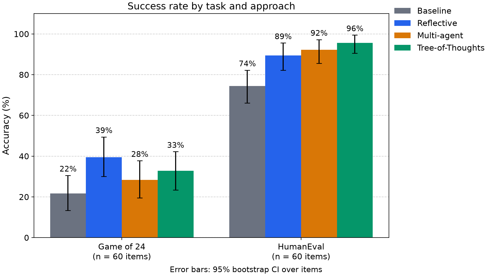
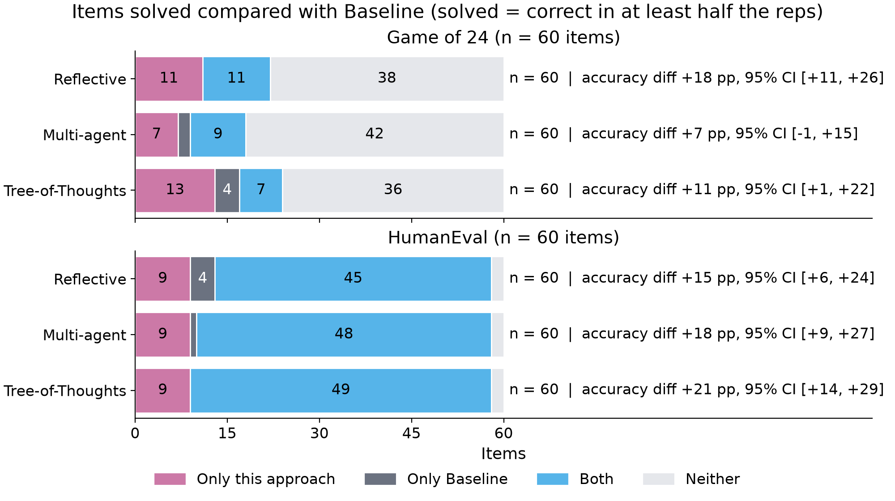
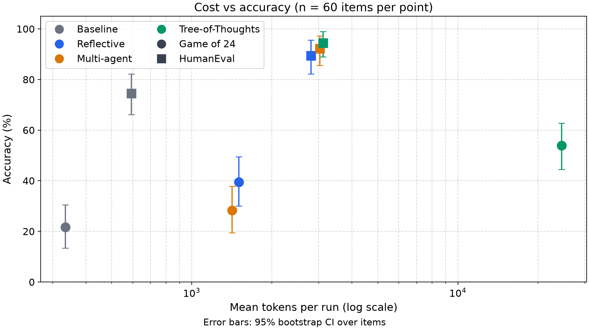
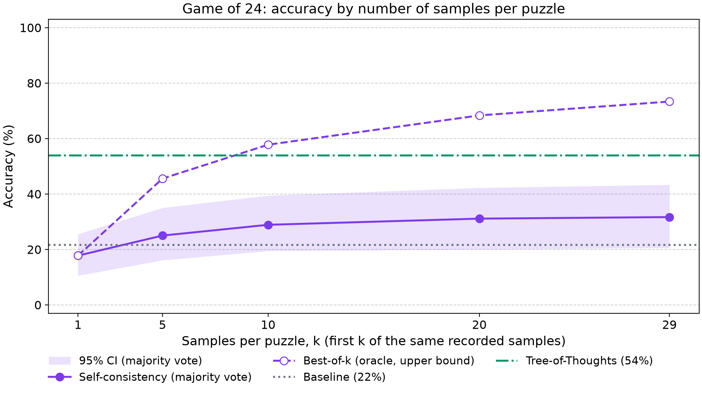

# agentic-compare

One LLM, four control flows: **Baseline**, **Reflective**, **Multi-agent** and
**Tree-of-Thoughts**. The same model with the same settings runs every approach on two tasks,
Game of 24 and HumanEval. For every run we record the accuracy, the cost (tokens and LLM calls)
and the wall time. A live web demo runs the four approaches side by side, and it can replay
recorded runs without a model or a network.

**The goal is not to find the best approach.** We want to show how each approach works, where
its gains come from and what they cost, so that one can decide which approach is worth it for
which kind of task. "Approach X gained this much, and this is what it spent" is the kind of
answer we are after, and so is "approach Y did not help".

## Contents

- [Results at a glance](#results-at-a-glance)
- [Quick start (replay demo, about 5 minutes)](#quick-start-replay-demo-about-5-minutes)
- [The question and the setup](#the-question-and-the-setup)
- [The four approaches](#the-four-approaches)
- [Results](#results)
- [Why the results look like this](#why-the-results-look-like-this)
- [How the project got here](#how-the-project-got-here)
- [How the code works](#how-the-code-works)
- [Running experiments](#running-experiments)
- [The demo](#the-demo)
- [Repository layout](#repository-layout)
- [Limitations](#limitations)
- [Data sources and references](#data-sources-and-references)

## Results at a glance

Test split, 60 items per task, 3 repetitions per item, model `gpt-4o-mini-2024-07-18`.
Differences are approach minus Baseline in percentage points, with 95% paired bootstrap
confidence intervals.

| Approach | Game of 24 | Tokens per run (Game of 24) | HumanEval | Tokens per run (HumanEval) |
|---|---|---|---|---|
| Baseline | 21.7% | 335 | 74.4% | 594 |
| Reflective | 39.4% (+17.8 [+11.1, +25.6]) | 1,503 | 89.4% (+15.0 [+6.1, +23.9]) | 2,802 |
| Multi-agent | 28.3% (+6.7 [-1.1, +15.0]) | 1,417 | 92.2% (+17.8 [+8.9, +26.7]) | 3,027 |
| Tree-of-Thoughts | 53.9% (+32.2 [+20.6, +43.9]) | 24,555 | 94.4% (+20.0 [+12.8, +27.8]) | 3,114 |

**Read the token columns with care: the budgets were not equal.** Reflective and Multi-agent
stop after at most 5 calls on Game of 24, and every one of their wrong runs ended at that limit.
Tree of Thoughts has no call limit, but it does not loop until it succeeds either: its
paper-like search always runs the same three levels (32-81 calls, median 65), whether or not it
finds the answer. So the table compares each approach in its usual setting, not at equal cost.

Why not simply give Reflective and Multi-agent as many calls as Tree of Thoughts? On Game of
24 they see the exact verifier result after every answer ("this evaluates to 34, not 24"). With
60 or more calls they could keep guessing until the verifier says yes, and the run would turn
into a brute-force search guided by the verifier. The score would then mostly measure access to
an exact checker, not how well the model reflects or how well the roles work together. Small
round limits keep these approaches what they are meant to be: a few rounds of feedback and
repair.

What we take from this:

- **Which approach pays off depends on the feedback available.** On Game of 24 an exact
  checker exists (is the expression 24?). With it, simply trying again is cheap: from our
  recorded samples, checking 10 plain answers and keeping a correct one would have solved 57.8%
  of the runs with about 3,400 tokens, about as often as Tree of Thoughts with about 24,600
  (exploratory, see [What more attempts would buy](#what-more-attempts-would-buy-exploratory)).
  Without a checker, the model has to judge its own partial solutions, and that is what Tree of
  Thoughts spends most of its tokens on.
- **Without a checker, wide search beat voting.** Tree of Thoughts and self-consistency (29
  plain samples and a majority vote) both work without the verifier. Tree of Thoughts beat the
  vote by 22.2 points (95% CI [+8.9, +35.6]) with about 2.5 times the tokens. The vote had
  stopped improving after about 10 samples, so the gap is probably not only budget. But at the
  same 29 calls, our first, lighter Tree of Thoughts (32.8%) was no better than the vote.
- **Tree of Thoughts in the paper's setting** gave the highest Game of 24 accuracy we measured,
  at about 24,600 tokens per puzzle, 84% of them for scoring.
- **Reflective** gained 18 points within 5 calls, helped by the exact verifier result.
  **Multi-agent**, with the same feedback, gained 7 points, within noise.
- **HumanEval (close to the model's ceiling):** the three agentic approaches cost about the
  same and land close together (89-94%). Their gain over Baseline is real; the differences
  between them are within noise.

Full tables: [`results/report.md`](results/report.md). Self-consistency study:
[`results/self_consistency/report.md`](results/self_consistency/report.md). Trace analysis of
Game of 24: [`results/game24_analysis.md`](results/game24_analysis.md).

## Quick start (replay demo, about 5 minutes)

Requirements:

- Python 3.11 or 3.12.
- Replay mode needs nothing else: no API key, no model, no network.
- Live mode and benchmark runs need an OpenAI API key (or [Ollama](https://ollama.com) with a
  local model).
- HumanEval runs (benchmark and the live HumanEval scene) also need Linux with
  [bubblewrap](https://github.com/containers/bubblewrap) (`sudo apt install bubblewrap`). On
  Windows, use WSL. See [Safety: running model-written code](#safety-running-model-written-code).

```sh
python -m venv .venv
# Windows: .venv\Scripts\activate    Linux/macOS: source .venv/bin/activate
pip install -r requirements.txt
python -m agentic.demo --replay-only
```

The browser opens `http://127.0.0.1:8000`. Pick a scene (Easy 24, Hard 24, HumanEval) and press
Space. The four columns replay recorded runs from `traces/examples/`. Press `?` for all
shortcuts.

Live demo: copy `.env.example` to `.env` and fill it in:

```
LLM_BACKEND=openai
OPENAI_API_KEY=<your key>
MODEL_NAME=gpt-4o-mini-2024-07-18
MACHINE_ID=openai-api
```

Then run `python -m agentic.demo`. The launcher checks the backend, warms the model with one
short call, starts the server and opens the browser. If the backend is not available it starts
in replay-only mode instead. Options: `--port`, `--no-browser`, `--replay-only`.

For a local model, set `LLM_BACKEND=ollama`, start Ollama and set `MODEL_NAME` to an installed
model.

## The question and the setup

### Question

Agentic approaches wrap an LLM in a control flow: let it check and fix its answer, split the
work into roles, or search over many partial solutions. These flows cost extra calls. We ask:
**which approach is worth its cost, for which kind of task, and why?**

### One variable only

Everything except the control flow is the same for all approaches:

- **Model:** GPT-4o mini through the OpenAI API, pinned snapshot `gpt-4o-mini-2024-07-18`.
- **Settings** (`configs/experiment.toml`): temperature 0.7, at most 1024 output tokens per
  call.
- **Items and seeds:** every approach sees the same items. The seed of a run is
  `seed + 1000 * rep + position of the item`, shared by all approaches for the same item and
  repetition; the k-th call inside a run uses `seed + k`.
- **Order:** for each item and repetition, the four approaches run back to back, so slow
  changes in network or server load do not favour one approach.
- **Control flow in our code:** the LLM only ever answers single calls. All loops, roles,
  trees and stopping rules are Python code in `agentic/approaches/`.

### Tasks

- **Game of 24 (main metric).** Use four numbers, each exactly once, with + - * / and
  parentheses to make 24. It needs search and backtracking, which is exactly where the
  approaches differ, and this model has room to improve on it. Answers are checked with exact
  fractions (`fractions.Fraction`), never floats. Each puzzle has a difficulty tier (easy,
  medium, hard) from its number of solution paths.
- **HumanEval (secondary).** Write a Python function from its docstring. The score comes only
  from the official tests, which no approach ever sees. We expected this model to be close to
  its ceiling here, so differences between approaches were expected to be small.

We fixed Game of 24 as the main metric before any test-set run.

### Dev and test split

- Settings and prompts were tuned once on a dev split (12 Game of 24 puzzles, 15 HumanEval
  problems) and then frozen.
- Results come only from the test split: 60 items per task, 3 repetitions per item and
  approach, so 720 runs per task in the main comparison.
- Demo scenes come from the dev split.

### Model choice

Our first plan was a 3B model running locally with Ollama. On the Game of 24 dev set it solved
almost no puzzles (2 of 24 at best), so there was no difference left to compare. We set a rule
before choosing a model: the Baseline should solve roughly 5-30% of Game of 24 (0% gives no
signal, close to 100% leaves no room to improve). GPT-4o mini solved 4 of 36 Baseline runs
(11%) on the dev puzzles, so we used it for every benchmark run and for the live demo. The
Ollama backend is still supported (`LLM_BACKEND=ollama`).

## The four approaches

All four use the same model and settings. The prompts are in `agentic/prompts/`.

### Baseline

One call, take the first answer. This is the reference for every comparison.

### Reflective: generate, check, critique, fix

1. A solver call answers the task, like the Baseline.
2. A feedback check judges the answer. Game of 24: our verifier says whether the expression is
   valid and equals 24. HumanEval: the docstring examples plus tests the model wrote itself.
3. If the check fails, a critic call explains what is wrong (without writing a new answer),
   then a reviser call writes a new answer from the old answer, the check result and the
   critique.

At most 3 answers in total (`max_attempts = 3`), so at most 5 calls on Game of 24. It stops as
soon as an answer passes the check. On HumanEval, a tester call first writes assert lines from
the task alone; the same tests are used for every attempt.

The idea follows Self-Refine (generate, feedback, refine with one model) and Reflexion (verbal
reflection on outside feedback, such as unit tests on HumanEval). It is our own implementation,
not a copy of either paper's code.

### Multi-agent: planner, solver, critic

One round:

1. A planner writes a short plan, without a final answer.
2. A solver follows the plan and writes the answer.
3. The same feedback check as Reflective.
4. If the check failed, a critic explains what went wrong with the plan and the answer.

In the next round the planner sees its old plan, the answer, the check result and the critic's
notes, and makes a new plan. At most 2 rounds (`max_rounds = 2`), so at most 5 calls on Game
of 24; it stops as soon as the check passes. Every agent call starts fresh: an agent sees only
what its prompt passes on, not a shared chat. On HumanEval, the tester writes assert lines
first, with the same prompt as Reflective.

The role split follows role-based multi-agent systems such as AgentCoder (programmer, test
designer, test executor). Multiagent debate is a related idea. Again, this is our own
implementation.

### Tree of Thoughts: breadth-first search with LLM scoring

**Game of 24**, following the paper (Yao et al., 2023) and its code
(princeton-nlp/tree-of-thought-llm, `scripts/game24/bfs.sh`, `src/tot/methods/bfs.py`):

1. **Propose.** For every kept node, one call lists possible next steps such as
   `4 + 8 = 12 (left: 6 12)`. Every line of this form becomes a child node.
2. **Score.** One call per child asks for 3 judgements in one request (`n = 3`) of whether the
   numbers left can still make 24: sure, likely or impossible. As in the paper, the labels are
   weighted (sure 20, likely 1, impossible 0.001) and summed. A state already scored in the
   same run reuses its score.
3. **Prune.** All children of the level are ranked by score, and only the best 5 survive.
4. Three levels (four numbers, three steps). Then a **writer** call turns the steps of the
   best-scored kept leaf whose numbers left are exactly 24 into one expression. If no kept leaf
   reached 24, there is no answer and the run counts as wrong.

The model's own steps and "left" numbers are used as written: code only reads the format, it
never checks the arithmetic and never feeds the verifier result back.

**HumanEval**, two levels: 3 plans (one call each), each scored once; the best 2 become code in
score order, and the first code that passes the docstring examples plus the model's own tests
is chosen. If none passes, the best plan's code is chosen.

### Self-consistency (separate study)

A control for Tree of Thoughts on Game of 24 only: 29 independent calls of the plain Baseline
prompt, each with its own seed, and a majority vote over the answers (spaces, extra
parentheses and the order of + and * operands do not matter; ties go to the answer seen first).
No verifier, no search. It asks: does Tree of Thoughts gain from its search, or just from
making many calls? It is reported only in `results/self_consistency/`, never in the main
comparison.

### Who sees what feedback

| | Baseline | Reflective | Multi-agent | Tree of Thoughts |
|---|---|---|---|---|
| Game of 24 | none | verifier result (exact) | verifier result (exact) | only its own LLM scores |
| HumanEval | none | docstring examples + own tests | docstring examples + own tests | docstring examples + own tests |
| Official tests or answer | never | never | never | never |

This difference is by design (it is part of how each approach works), and it matters for the
results, see [Why the results look like this](#why-the-results-look-like-this).

## Results

All numbers come from `results/`, which is rebuilt from the traces by
`python -m scripts.update_results`. Every run is validated first (see
[Validation](#validation)): 1440 runs passed, no items were dropped.

### Success rate

| Approach | Game of 24 [95% CI] | HumanEval [95% CI] |
|---|---|---|
| Baseline | 21.7% [13.3, 30.6] | 74.4% [66.1, 82.2] |
| Reflective | 39.4% [30.0, 49.4] | 89.4% [82.2, 95.6] |
| Multi-agent | 28.3% [19.4, 37.8] | 92.2% [85.6, 97.2] |
| Tree-of-Thoughts | 53.9% [44.4, 62.8] | 94.4% [88.9, 98.9] |



Items solved (correct in at least half the repetitions) compared with Baseline:

| Game of 24 | Only this approach | Only Baseline | Both | Neither |
|---|---|---|---|---|
| Reflective | 11 | 0 | 11 | 38 |
| Multi-agent | 7 | 2 | 9 | 42 |
| Tree-of-Thoughts | 22 | 3 | 8 | 27 |



### Cost and budget

Means per run. Cost in USD uses the token counts from the traces and the price of
`gpt-4o-mini-2024-07-18` on 11 Nov 2026: 0.15 USD per 1M input tokens, 0.60 USD per 1M output
tokens.

| Game of 24 | LLM calls | Tokens | Tokens per correct answer | USD per 1,000 runs | Wall time (s) |
|---|---|---|---|---|---|
| Baseline | 1.0 | 335 | 1,547 | 0.18 | 4.2 |
| Reflective | 3.9 | 1,503 | 3,811 | 0.67 | 15.3 |
| Multi-agent | 4.5 | 1,417 | 4,999 | 0.50 | 11.3 |
| Tree-of-Thoughts | 64.3 | 24,555 | 45,566 | 7.01 | 96.4 |

| HumanEval | LLM calls | Tokens | Tokens per correct answer | USD per 1,000 runs | Wall time (s) |
|---|---|---|---|---|---|
| Baseline | 1.0 | 594 | 797 | 0.29 | 6.2 |
| Reflective | 4.1 | 2,802 | 3,133 | 0.91 | 16.0 |
| Multi-agent | 4.5 | 3,027 | 3,282 | 0.92 | 15.9 |
| Tree-of-Thoughts | 8.4 | 3,114 | 3,297 | 0.99 | 20.7 |



**Budget view, Game of 24.** The approaches do not get the same budget:

- Reflective and Multi-agent stop after at most 5 calls. The limit was reached by all 109 wrong
  Reflective runs and all 129 wrong Multi-agent runs, so more attempts might have helped them.
- Tree of Thoughts has a fixed search shape instead of a call limit: three levels, 5 kept nodes,
  every proposed step scored. It made 32-81 calls (median 65) and does not stop early when it
  finds the answer.

We did not equalize budgets (see [Limitations](#limitations)), but two extra data points show
how accuracy grows with the budget:

| Game of 24 | LLM calls | Tokens | Accuracy |
|---|---|---|---|
| Baseline | 1 | 335 | 21.7% |
| Reflective | 3.9 | 1,503 | 39.4% |
| Self-consistency (separate study) | 29 | 9,920 | 31.7% |
| First, lighter Tree of Thoughts (first test run) | 29 | 9,346 | 32.8% |
| Tree of Thoughts (paper-like, main result) | 64.3 | 24,555 | 53.9% |

The first, lighter Tree of Thoughts differs from the main one in more than its budget (its
writer step also differed, see [How the project got here](#how-the-project-got-here)), so read
it as an earlier version, not as a clean budget point.

### What more attempts would buy (exploratory)

Reflective and Multi-agent were cut off at 5 calls, so we cannot measure them at a larger
budget. The self-consistency samples give an estimate for the simplest strategy an approach
with the verifier could use: draw plain Baseline answers and stop at the first one the verifier
accepts. "Best-of-k" below is the share of runs in which at least one of the first k samples was
correct; tokens are k times the mean tokens of one sample (stopping at the first correct answer
would cost less).

| Game of 24 | Tokens (about) | Accuracy |
|---|---|---|
| Best-of-5 with the verifier | 1,700 | 45.6% |
| Best-of-10 with the verifier | 3,400 | 57.8% |
| Tree of Thoughts (paper-like, no verifier) | 24,555 | 53.9% |
| Best-of-29 with the verifier | 9,900 | 73.3% |

This is computed after the fact from the same recorded samples, not from separate runs, and
this retry strategy is not our Reflective approach (it has no critique step). It shows how much
an exact checker is worth: with it, plain retries reach Tree of Thoughts' accuracy at a fraction
of its tokens. Tree of Thoughts does not use the checker; its scorer is the model judging
itself.

### Self-consistency (separate study)

| Game of 24 | Accuracy [95% CI] | LLM calls | Tokens per correct answer |
|---|---|---|---|
| Baseline | 21.7% [13.3, 30.6] | 1 | 1,547 |
| Tree-of-Thoughts | 53.9% [44.4, 62.8] | 64.3 | 45,566 |
| Self-consistency (vote) | 31.7% [21.1, 43.3] | 29 | 31,325 |
| Best-of-29 (oracle, not an approach) | 73.3% [63.3, 82.8] | (same samples) | n/a |

The oracle checks every sample with the official check and counts a run as correct when any
sample is right. No approach can do this; it shows how often a right answer was among the
samples at all.

| Samples k | Majority vote | Best-of-k oracle |
|---|---|---|
| 1 | 17.8% | 17.8% |
| 5 | 25.0% | 45.6% |
| 10 | 28.9% | 57.8% |
| 20 | 31.1% | 68.3% |
| 29 | 31.7% | 73.3% |



More figures: `results/cumulative.png` (accuracy as items are added, over 200 random orders),
`results/rep_spread.png` (accuracy of each repetition), `results/time_and_calls.png`,
`results/self_consistency/sc_success.png`, `results/game24_tot_funnel.png`.

## Why the results look like this

### Baseline: the right numbers, the wrong value

86% of the wrong Baseline answers on Game of 24 use the right four numbers, but the expression
does not equal 24 (from `results/game24_analysis.md`). One call usually writes a plausible
expression and does not check it.

### Reflective: exact outside feedback does most of the work

On Game of 24, Reflective sees the verifier result: "this expression evaluates to 34, not 24".
That is exact outside feedback, and it tells the model precisely when to stop. Part of the
Reflective gain therefore comes from the verifier, not from the reflection loop alone. This
matches the finding of Huang et al. (2023) that LLMs struggle to correct their reasoning
without outside feedback. On HumanEval, the feedback is weaker (docstring examples and the
model's own tests), yet it still lifts the score by 15 points.

### Multi-agent: same feedback, more hand-offs

Multi-agent gets the same verifier feedback as Reflective but did worse on Game of 24 (within
noise of Baseline). In the traces we looked at, the planner often writes a plan that cannot
work, and the solver either follows it or drifts away from it; with only 2 rounds there is
little room to recover. On HumanEval, where the plan is a natural first step, it is on par with
the other agentic approaches.

### Tree of Thoughts: where its tokens go

On Game of 24, one Tree of Thoughts run makes 64 calls and uses about 24,600 tokens on average.
This cost comes from the shape of the search, not from a longer allowance: the same three
levels run for every puzzle. Where the tokens go, per run:

| Role | Calls | Input tokens | Output tokens |
|---|---|---|---|
| Proposer | 11.0 | 2,631 | 1,093 |
| Scorer | 52.5 | 14,344 | 6,183 |
| Writer | 0.8 | 194 | 110 |

- **Every proposed step is scored.** Each proposer call adds about 6 new steps (4-8 for most
  calls), and each one becomes a node: about 67 nodes per run. Each node needs a scorer call
  (20% reuse a cached score). The scorer makes up 84% of the tokens. Our first Tree of
  Thoughts kept only the first 3 steps per node.
- **Three judgements per node.** Each scorer call asks for 3 judgements in one request. That
  does not add calls, but the model writes three times the output, and output tokens are both
  the slow part and the expensive part (4 times the input price).
- **Five nodes per level.** Five kept nodes each propose children at the next level.
- **No early stop.** The search always finishes all three levels, even when a solution is
  already in the tree, as in the paper's code. Right and wrong runs take about the same time
  (95 s and 99 s).
- **Calls run one after another.** The scorer calls of a level wait for each other, so wall
  time grows with the number of calls.

On HumanEval, Tree of Thoughts is a small tree (3 plans, 2 codes), so its cost is close to the
other agentic approaches.

### Tree of Thoughts: where it loses the solution

For each run we followed the search level by level (`results/game24_analysis.md`). A node is
sound when every step on its path is right and its numbers can still make 24.

| Outcome of the search | Runs | Final answer correct |
|---|---|---|
| Depth 1: no sound step proposed | 24 (13%) | 0 |
| Depth 1: all sound nodes pruned by the scorer | 8 (4%) | 0 |
| Depth 2: no sound step proposed | 14 (8%) | 1 |
| Depth 2: all sound nodes pruned by the scorer | 1 (1%) | 0 |
| Depth 3: all sound nodes pruned by the scorer | 4 (2%) | 1 |
| Reached a sound 24 leaf | 129 (72%) | 95 |

- The search found a sound path to 24 in 72% of the runs. Most losses before that come from
  the proposer (no sound step at all), not from the scorer.
- The scorer is good at ruling out: 98% of its "impossible" judgements were right. "Sure" was
  right only 64% of the time.
- 34 runs reached a sound 24 leaf but still ended wrong: the writer step did not turn that path
  into a correct expression.
- Of the 83 wrong Tree of Thoughts answers, 41 were "no answer": no kept leaf reached 24.

### Self-consistency: the answer is often there, the vote does not find it

With 29 samples, a right answer was among them in 73% of the runs, but the majority vote picked
it only in 32%. A wrong expression that appears often wins the vote, and more samples hardly
help: the vote reached 28.9% with 10 samples, 31.1% with 20 and 31.7% with 29.

Neither self-consistency nor Tree of Thoughts sees the verifier. Tree of Thoughts uses its
scorer to keep only promising partial steps, and it beat the vote by 22.2 points (95% CI
[+8.9, +35.6]) with about 2.5 times the tokens. Because the vote had flattened out, more
samples would probably not have closed the gap; we did not measure it. With the same 29 calls,
our first and lighter Tree of Thoughts was no better than the vote, so the search helps only
when it is wide enough.

### HumanEval: close to the ceiling

Baseline already solves 74%. Every agentic approach gains 15-20 points by checking its code
against tests before answering, and they end within 5 points of each other. With 60 items,
such differences are noise.

## How the project got here

The design was fixed step by step, and some results changed the plan. We report the earlier
results too.

1. **Local model dropped.** A 3B model on Ollama solved almost no Game of 24 puzzles on the dev
   set, so we switched to GPT-4o mini after it passed the 5-30% Baseline rule on dev (11%).
2. **Dev check and freeze.** On the dev set: Reflective 4/12, Multi-agent 0/12, Tree of
   Thoughts 5/12 (one repetition). We checked the Multi-agent result for bugs and found none:
   the planner wrote wrong plans and the solver drifted. We did not tune prompts to fix it.
   Settings were frozen; only the token limit was raised from 512 to 1024 after HumanEval code
   was cut off on dev.
3. **First test run (11 Nov 2026).** 1440 runs. Tree of Thoughts used a lighter search: the
   first 3 proposed steps per node, one judgement per node (weights 1 / 0.5 / 0), the best 3
   nodes per level, and a writer that always turned the best path into an answer, even when
   that path did not end at 24. Result: Game of 24 32.8% (+11.1 [+0.6, +22.2]) at 29 calls;
   HumanEval 95.6%.
4. **Trace analysis of the first run.**
   - The writer often ignored the tree: 6 of the 59 correct answers came from a path that did
     not reach 24 (the writer wrote a new answer), and 21 wrong answers had a path that ended
     at 24.
   - At the first level, the first 3 proposed steps contained a sound step in 64% of the
     runs; all lines the model wrote contained one in 87%.
   - We then compared our search line by line with the paper's code and found four
     differences: all proposed lines, 3 judgements with weights 20 / 1 / 0.001, 5 kept nodes,
     and a writer only for states that reached 24.
5. **Tree of Thoughts made to follow the paper.** We changed all four points and re-ran Tree
   of Thoughts on the test set; the reported result (53.9%) uses this search. The change came
   after seeing the first test results. Its reason was fidelity to the paper, not the score;
   the old runs are kept out of the results automatically (their settings hash differs) and
   listed in `results/validation.md`.
6. **Self-consistency added** as a separate control study at 29 samples, the budget of the
   first Tree of Thoughts.
7. **Safer code execution.** HumanEval code now runs in a bubblewrap sandbox. All 164
   reference solutions pass their official tests in it, and re-scoring the HumanEval answers
   recorded before the change gave the same result for every run.

## How the code works

### Event traces: one source of truth

Every run writes its full history as JSON lines: prompts, answers, token counts, timings, and
approach-specific events (attempts and critiques, role messages, tree nodes added, scored,
pruned and the chosen path). Analysis, figures and the demo replay read **only** these traces.

- `agentic/events.py` defines the event types. An approach only yields event bodies; the
  runner adds the envelope (run id, order, time). Every trace line stands on its own.
- An approach ends with `FinalAnswer`. The runner then adds `RunEnd` with the official
  verdict, so official tests never reach an approach.

### Runner

`agentic/runner.py` runs the approaches on the items of a split and writes
`traces/runs/<task>-<split>-<model>-<machine_id>[-<tag>]/trace.jsonl`. It is resumable:
running the same command again skips every run that already ended with status ok. If the
settings of an approach changed, it refuses to mix old and new runs.

### Validation

`scripts/update_results.py` (with `agentic/analysis/validate.py`) checks every run before it
enters the results:

- finished with status ok, with the expected mode, split and model;
- the settings hash equals the frozen settings in `configs/experiment.toml`;
- the seed is the one the runner sets, and the item is in the split;
- token and call totals equal the LLM call events;
- exactly one final answer, equal to the scored answer;
- a fresh official re-score gives the same verdict.

An item is kept only if every approach has a valid run for every repetition. What was left out
and why is written to `results/validation.md`.

### Analysis

- `agentic/analysis/stats.py`: bootstrap confidence intervals and paired differences.
- `agentic/analysis/plots.py` and `scripts/make_report.py`: figures and `results/report.md`.
- `scripts/analyze_game24.py`: error types, Tree of Thoughts scorer calibration, step
  correctness and the funnel of where the search lost the solution.
- `agentic/analysis/self_consistency.py`: the separate self-consistency study.

### Demo server

`agentic/server/` is a FastAPI app that streams events to the page with server-sent events.
Live mode runs the same `runner.run_one` code as the benchmark, so a live run produces exactly
the trace lines a replay reads. The page (`agentic/server/static/`) is plain JavaScript with a
vendored copy of d3, no build step and no CDN, so replay works offline.

### Safety: running model-written code

HumanEval runs code that the model wrote. `agentic/sandbox.py` runs it in a separate process
inside a [bubblewrap](https://github.com/containers/bubblewrap) box:

- no network, an empty environment (no keys, no tokens);
- the home folder, the repository and `.env` do not exist inside the box;
- system files are read-only; only a small in-memory `/work` and `/tmp` are writable;
- limits on memory (1 GB), CPU time, file size (16 MB), open files and processes (64), set
  inside the box so the code cannot raise them;
- a timeout that kills the whole box.

Without bubblewrap the code is not run, and HumanEval runs stop before any model call. Setting
`AGENTIC_ALLOW_BASIC_SANDBOX=1` allows a weaker basic sandbox instead (separate process,
timeout, temporary folder, no keys in the environment), without network, file or memory
isolation. The test suite sets it, since it runs only its own fixed code. Game of 24 never runs
model output: answers are parsed with Python's `ast` module and evaluated by our own small
walker with exact fractions.

## Running experiments

Benchmark runs need an API key in `.env` (see [Quick start](#quick-start-replay-demo-about-5-minutes)).

```sh
# Dev split (tuning only)
python -m agentic.runner --task game24 --split dev --approach baseline --reps 3

# Test split, the main four approaches
python -m agentic.runner --task game24 --split test
python -m agentic.runner --task humaneval --split test

# Self-consistency runs only when named
python -m agentic.runner --task game24 --split test --approach self_consistency

# Validate all traces and rebuild results/
python -m scripts.update_results

# Record the demo replay scenes into traces/examples/
python -m scripts.record_demo
```

Useful options: `--limit N` (first N items), `--approach baseline,tot`, `--tag name` (a new
experiment folder), `--no-update` (do not rebuild `results/` after a test run).

Rough cost of the full test runs at the prices above: the four main approaches on both tasks
about 1.2 USD; Tree of Thoughts on Game of 24 alone about 1.3 USD; self-consistency about
0.9 USD. The whole project, including dev runs, reruns and demo recordings, used about 3.9 USD.

Tests: `pip install -r requirements-dev.txt`, then `python -m pytest -q` and
`python -m ruff check .`.

## The demo

Four columns, one per approach, run on the same puzzle one after another. Each column shows a
status chip, token, call and time counters, and its own view: an answer card (Baseline),
attempt cards with critique and verifier badges (Reflective), role messages (Multi-agent), and
a growing tree (Tree of Thoughts). In the tree, pruned nodes turn grey, several pruned leaves
under one parent are shown as one "+N pruned" node, and the winning path turns green. A
summary strip at the bottom compares the four. The official check is shown at the end of each
column; no approach ever sees it.

- **Scenes:** Easy 24, Hard 24 and HumanEval, plus "Draw card", which picks a random puzzle
  from a curated pool. All demo puzzles come from the dev split.
- **Live and replay** share the same event stream. Replay works offline and can run faster
  (0.5x to 8x).
- **Tabs:** Demo, Results (figures from `results/`), Self-consistency.
- The demo uses the benchmark settings, so a live Game of 24 scene takes about 2-3 minutes,
  most of it in the Tree of Thoughts column. Demo runs are never mixed into the results.

| Key | Action |
|---|---|
| 1-9 | Choose a scene |
| Space | Start |
| R | Reset |
| L | Switch live / replay |
| D | Draw card |
| + / - | Replay faster / slower |
| T | Next tab |
| F | Full screen |
| ← / → | Previous / next figure (Results tab) |
| N / S | After a failed live scene: switch to replay now / stay live |
| ? | Help |

## Repository layout

```
agentic/
  approaches/      baseline.py, reflective.py, multi_agent.py, tot.py, self_consistency.py;
                   base.py holds the Approach contract and the Caller (seeds, call ids)
  tasks/           game24.py (exact fraction checker, difficulty tiers),
                   humaneval.py (official tests stay private), base.py (Task contract)
  llm/             openai_api.py, ollama.py, backend.py (picks one from .env), base.py
  prompts/         one text file per approach, role and task
  analysis/        validate.py, stats.py, plots.py, self_consistency.py
  server/          app.py (FastAPI + SSE), live.py (live runs), sessions.py, static/ (page)
  events.py        event types of the trace
  traces.py        reading and writing JSONL traces
  runner.py        benchmark runner
  sandbox.py       bubblewrap sandbox for model-written code
  demo.py          one-command demo launcher
  demo_config.py   demo scenes and draw-card pool
  config.py        paths, .env and TOML loading
configs/
  experiment.toml  frozen benchmark settings
  demo.toml        demo scenes and pool (uses the benchmark settings)
data/
  game24/          24.csv (1362 puzzles) and its licence
  humaneval/       HumanEval.jsonl.gz (164 problems) and its licence
  splits/          dev/test split of Game of 24 (HumanEval splits are fixed in code)
results/           runs.csv, report.md, validation.md, figures, game24_analysis.md,
                   self_consistency/
traces/
  examples/        recorded demo scenes (replay mode)
  runs/            benchmark traces (not committed, too large)
scripts/
  update_results.py   validate traces, rebuild results/
  make_report.py      tables and figures
  analyze_game24.py   Game of 24 trace analysis
  record_demo.py      record the demo scenes
  smoke_test.py       quick end-to-end check on a few items
  fetch_data.py, fetch_humaneval.py, make_splits.py   data download and splits
  make_mock_traces.py, make_fake_results.py           fake data for UI and report tests
  speed_test.py, check_humaneval_examples.py          helpers
tests/             unit tests (pytest)
```

## Limitations

- **One model, small samples.** All results come from one model on 60 test items per task with
  3 repetitions. We treat differences below about 15 percentage points as noise and report 95%
  bootstrap confidence intervals.
- **Unequal budgets, by design.** On Game of 24, Reflective and Multi-agent stop after at most
  5 calls, and all their wrong runs reached that limit; Tree of Thoughts made 32-81 calls
  (about 16 times the tokens of Reflective). We measured cost instead of fixing it, so the
  results answer "what does each approach gain in its usual setting, and at what cost", not
  "which approach wins at equal cost". We cannot say that Tree of Thoughts is more expensive
  than Reflective for the same accuracy. Giving Reflective the same budget would mostly let it
  try again and again against the exact verifier; the best-of-k estimate above suggests that
  this would be much cheaper than Tree of Thoughts, but it would measure access to the
  verifier more than reflection.
- **Unequal access to feedback, by design.** On Game of 24, Reflective and Multi-agent see the
  exact verifier result; Baseline and Tree of Thoughts do not. Part of the Reflective gain is
  therefore outside feedback, not the loop alone.
- **Settings frozen once.** Settings and prompts were tuned once on the dev set. They were not
  tuned separately for each approach, so a better prompt could change any single result. The
  Tree of Thoughts propose prompt contains a short format example; the other prompts do not.
- **Tree of Thoughts changed after the first test run.** Before freezing, we had not compared
  our Game of 24 search line by line with the paper's code. We changed it to follow the paper
  after seeing the first results (see [How the project got here](#how-the-project-got-here)).
  Remaining differences from the paper: three levels and one writer call, without the paper's
  last step in which the model judges the written answers; repeated states are scored once per
  run (the paper keeps a cache across puzzles); duplicate lines under the same parent are
  skipped (the paper gives them the value 0).
- **Only Tree of Thoughts follows a paper's code.** Reflective and Multi-agent follow the ideas
  of Self-Refine, Reflexion and role-based systems such as AgentCoder, but they are our own,
  simpler implementations with small round limits.
- **Self-consistency is not budget-matched** to the final Tree of Thoughts (29 calls against
  64), so compare them by tokens per correct answer.
- **HumanEval is close to the ceiling** for this model, so differences between the agentic
  approaches there are small and within noise.
- **Wall time** with a cloud API includes network and server load. Tokens and LLM calls are
  the main cost measures.

## Data sources and references

### Data

- **Game of 24:** `data/game24/24.csv`, 1362 puzzles from the Tree of Thoughts authors,
  repository [princeton-nlp/tree-of-thought-llm](https://github.com/princeton-nlp/tree-of-thought-llm),
  MIT licence (copy in `data/game24/LICENSE`). The authors collected the puzzles from
  4nums.com. Re-download with `python -m scripts.fetch_data` (pinned commit, SHA-256 checked).
  Our approaches and prompts are our own. The Tree of Thoughts prompts for Game of 24
  (`agentic/prompts/game24_tot_*.txt`) follow the step format of the paper
  ("a op b = c (left: ...)", sure/likely/impossible) with our own wording and examples.
- **HumanEval:** `data/humaneval/HumanEval.jsonl.gz`, 164 Python problems from OpenAI,
  repository [openai/human-eval](https://github.com/openai/human-eval), MIT licence (copy in
  `data/humaneval/LICENSE`). Re-download with `python -m scripts.fetch_humaneval`. Final scores
  come only from the official tests, which no approach ever sees.

### Papers

- Yao et al., 2023. *Tree of Thoughts: Deliberate Problem Solving with Large Language Models.*
  [arXiv:2305.10601](https://arxiv.org/abs/2305.10601)
- Wang et al., 2022. *Self-Consistency Improves Chain of Thought Reasoning in Language Models.*
  [arXiv:2203.11171](https://arxiv.org/abs/2203.11171)
- Madaan et al., 2023. *Self-Refine: Iterative Refinement with Self-Feedback.*
  [arXiv:2303.17651](https://arxiv.org/abs/2303.17651)
- Shinn et al., 2023. *Reflexion: Language Agents with Verbal Reinforcement Learning.*
  [arXiv:2303.11366](https://arxiv.org/abs/2303.11366)
- Huang et al., 2023. *Large Language Models Cannot Self-Correct Reasoning Yet.*
  [arXiv:2310.01798](https://arxiv.org/abs/2310.01798)
- Huang et al., 2023. *AgentCoder: Multi-Agent-based Code Generation with Iterative Testing and
  Optimisation.* [arXiv:2312.13010](https://arxiv.org/abs/2312.13010)
- Du et al., 2023. *Improving Factuality and Reasoning in Language Models through Multiagent
  Debate.* [arXiv:2305.14325](https://arxiv.org/abs/2305.14325)
- Chen et al., 2021. *Evaluating Large Language Models Trained on Code.*
  [arXiv:2107.03374](https://arxiv.org/abs/2107.03374)

## License

MIT, see [LICENSE](LICENSE).
