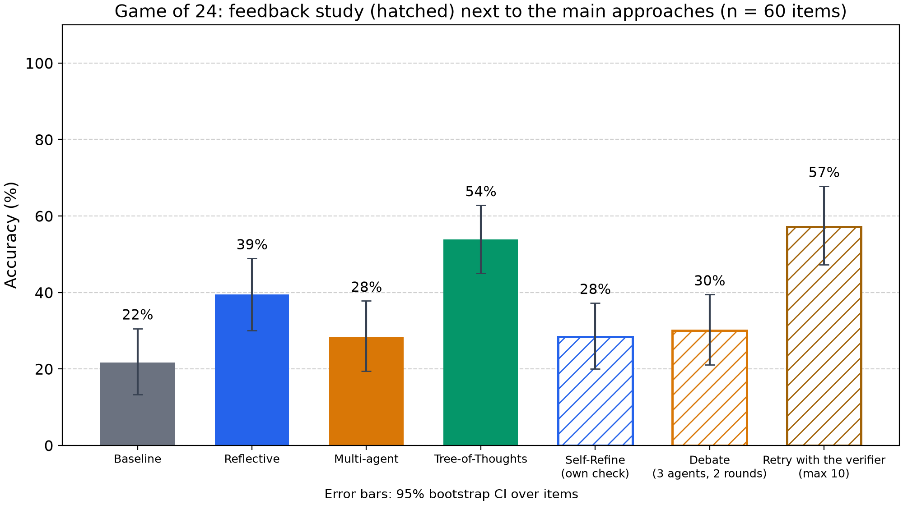
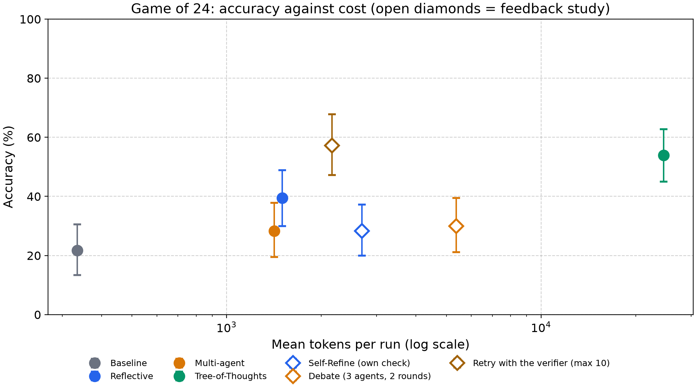

# Feedback study (separate study, Game of 24)

Generated 2026-11-13 10:41 +03 by `python -m scripts.update_results`.

This study is NOT part of the main results. It was added after the main test runs and asks how much of the gains come from the exact verifier, and how a paper-like multi-agent setup compares with ours:

- **Self-Refine (own check):** the Reflective loop (at most 3 answers, critique, revise), but the model checks its own answer instead of seeing the verifier result. It stops when its own check says the answer is correct.
- **Debate:** 3 agents answer, then each sees the other agents' answers and gives an updated answer (2 rounds); majority vote over the last answers; no verifier (Du et al., 2023).
- **Retry with the verifier:** plain baseline answers until the verifier accepts one, at most 10; no critique.

Model `gpt-4o-mini-2024-07-18`, split `test`, 3 reps, 60 items. Main approaches come from the main `results/runs.csv`, on the same items.

## Accuracy and cost

| Approach | Sees the verifier | Accuracy [95% CI] | Mean LLM calls | Mean tokens | Tokens per correct |
|---|---|---|---|---|---|
| Baseline | no | 21.7% [13.3, 30.6] | 1.0 | 335 | 1,547 |
| Reflective | yes | 39.4% [30.0, 48.9] | 3.9 | 1,503 | 3,811 |
| Multi-agent | yes | 28.3% [19.4, 37.8] | 4.5 | 1,416 | 4,999 |
| Tree-of-Thoughts | no | 53.9% [45.0, 62.8] | 64.3 | 24,555 | 45,566 |
| Self-Refine (own check) | no | 28.3% [20.0, 37.2] | 5.6 | 2,694 | 9,508 |
| Debate (3 agents, 2 rounds) | no | 30.0% [21.1, 39.4] | 6.0 | 5,370 | 17,901 |
| Retry with the verifier (max 10) | yes | 57.2% [47.2, 67.8] | 5.8 | 2,161 | 3,777 |

## Paired differences (percentage points, 95% bootstrap CI over items)

- Self-Refine (own check) minus Baseline: +6.7 [-0.6, +13.9], n = 60 items
- Reflective minus Self-Refine (own check): +11.1 [+2.8, +19.4], n = 60 items
- Debate (3 agents, 2 rounds) minus Baseline: +8.3 [+1.1, +15.6], n = 60 items
- Debate (3 agents, 2 rounds) minus Multi-agent: +1.7 [-7.8, +10.6], n = 60 items
- Retry with the verifier (max 10) minus Reflective: +17.8 [+9.4, +26.7], n = 60 items
- Retry with the verifier (max 10) minus Tree-of-Thoughts: +3.3 [-8.9, +16.1], n = 60 items

Differences below about 15 points are treated as noise at this sample size (project rule).

## How often the model's own check was right (Self-Refine)

| The model said | Answer really correct | Answer really wrong |
|---|---|---|
| correct (38 checks) | 36 | 2 |
| wrong (463 checks) | 55 | 408 |

When the model accepted its own answer, the answer was really correct in 95% of the checks.

## Retry with the verifier

Mean answers per run: 5.8 (at most 10).

## Figures

Only runs that passed the checks are included: see `validation.md`.
