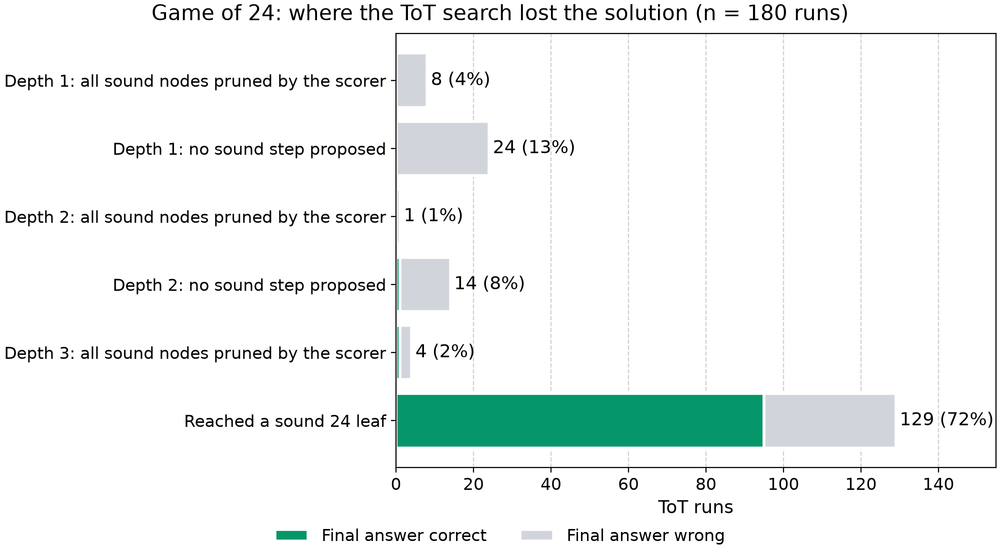
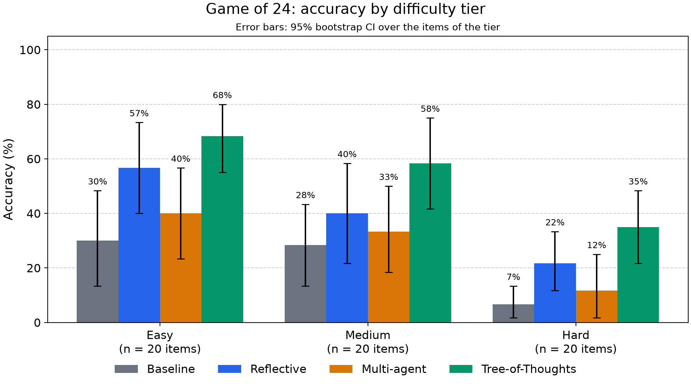

# Game of 24: error types and ToT search analysis

Computed from the traces of the validated test runs (the runs in `runs.csv`) by `python -m scripts.analyze_game24`. No model calls.

## Why final answers are wrong (official check message)

| Approach | Wrong runs | Right numbers, value not 24 | Wrong numbers used | Unreadable or not allowed | Division by zero | No answer |
|---|---|---|---|---|---|---|
| baseline | 141 | 121 (86%) | 15 (11%) | 3 (2%) | 2 (1%) | 0 (0%) |
| reflective | 109 | 66 (61%) | 23 (21%) | 19 (17%) | 1 (1%) | 0 (0%) |
| multi_agent | 129 | 96 (74%) | 20 (16%) | 13 (10%) | 0 (0%) | 0 (0%) |
| tot | 83 | 6 (7%) | 17 (20%) | 19 (23%) | 0 (0%) | 41 (49%) |

## Tree of Thoughts

### Scorer labels vs. the truth

For every judgement of a scored state (cached repeats not counted again): can its numbers left, as the model wrote them, still make 24 (checked exactly)?

| Label | Judgements | Really reachable | Unreachable | Unreadable |
|---|---|---|---|---|
| sure | 2886 | 64% | 36% | 0% |
| likely | 4864 | 14% | 85% | 0% |
| impossible | 20608 | 2% | 98% | 0% |
| unknown | 1 | 0% | 100% | 0% |

### Proposed steps

A step is right when its arithmetic is exact and the numbers left are the parent's minus the two used plus the result.

| Depth | Steps | Right |
|---|---|---|
| 1 | 1335 | 88% |
| 2 | 5940 | 86% |
| 3 | 4591 | 86% |

### Where the search lost the solution

A node is sound when every step on its path is right and its numbers can still make 24. For each run: the first level with no sound node, or where every sound node was pruned.

| Outcome of the search | Runs | Share | Final answer correct |
|---|---|---|---|
| depth 1: all sound nodes pruned by the scorer | 8 | 4% | 0 |
| depth 1: no sound step proposed | 24 | 13% | 0 |
| depth 2: all sound nodes pruned by the scorer | 1 | 1% | 0 |
| depth 2: no sound step proposed | 14 | 8% | 1 |
| depth 3: all sound nodes pruned by the scorer | 4 | 2% | 1 |
| reached a sound 24 leaf | 129 | 72% | 95 |

### More proposals at the root (exploratory)

Root proposer calls with at least one sound step among the lines used (the first `breadth`, or all with `breadth = 0`): 156 of 180 (87%); among all lines the model wrote: 156 (87%). The paper's code uses every proposed line, as `breadth = 0` does; the first test run used `breadth = 3`.

## Accuracy by difficulty

Difficulty tiers come from the number of solution paths of each puzzle (tertiles over all 1362 puzzles; easy puzzles have the most paths). Mean accuracy over all repetitions; 95% bootstrap CI over the items of the tier.

| Approach | easy (20 items) | medium (20 items) | hard (20 items) |
|---|---|---|---|
| Baseline | 30% [13, 48] | 28% [13, 43] | 7% [2, 13] |
| Reflective | 57% [40, 73] | 40% [22, 58] | 22% [12, 33] |
| Multi-agent | 40% [23, 57] | 33% [18, 50] | 12% [2, 25] |
| Tree-of-Thoughts | 68% [55, 80] | 58% [42, 75] | 35% [22, 48] |

