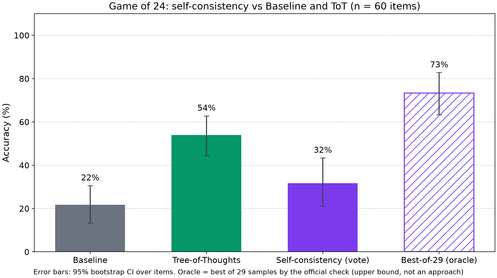
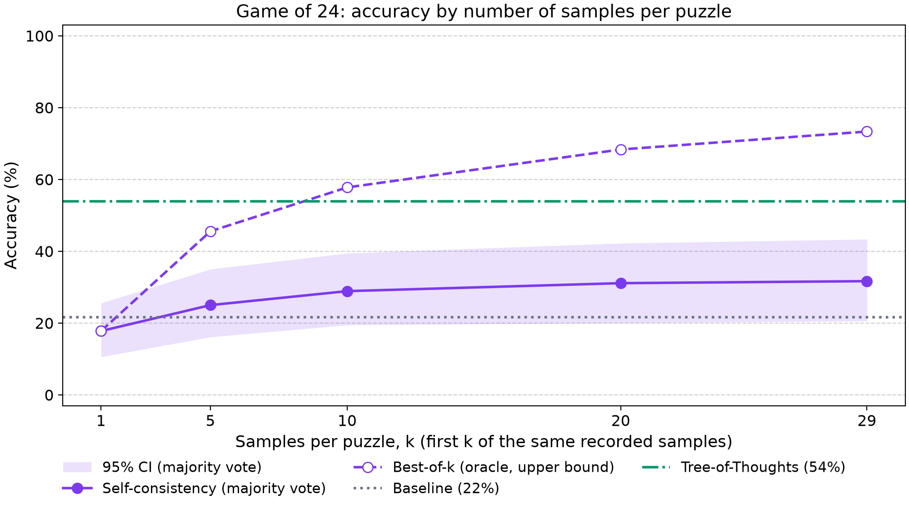

# Self-consistency (separate study, Game of 24)

Generated 2026-11-12 12:47 +03 by `python -m scripts.update_results`.

This study is NOT part of the main results. It asks one question: does ToT's gain come from its search, or just from making many calls? Self-consistency makes 29 calls, each one the plain baseline prompt with its own seed, and answers by majority vote over the answers (spaces, extra parentheses and the order of + and * operands ignored; ties go to the answer seen first). It uses no verifier and no search. The number of calls matches our first, lighter ToT, not the paper-like ToT of the main results, so compare cost by tokens per correct answer.

Model `gpt-4o-mini-2024-07-18`, split `test`, 3 reps, 60 items shared with the main results. Baseline and ToT rows come from the main `results/runs.csv`.

## Accuracy

| Approach | Accuracy [95% CI] | Mean LLM calls | Mean tokens | Tokens per correct |
|---|---|---|---|---|
| Baseline | 21.7% [13.3, 30.6] | 1.0 | 335 | 1,547 |
| Tree-of-Thoughts | 53.9% [44.4, 62.8] | 64.3 | 24,555 | 45,566 |
| Self-consistency (vote) | 31.7% [21.1, 43.3] | 29.0 | 9,920 | 31,325 |
| Best-of-29 (oracle) | 73.3% [63.3, 82.8] | (same samples) | (same samples) | n/a |

The oracle row checks every sample with the official check and counts a run as correct when any sample is right. No approach can do this; it only shows how often a right answer was among the samples at all.

## Paired differences (percentage points, 95% bootstrap CI over items)

- Self-consistency (vote) minus Baseline: +10.0 [+3.9, +16.7], n = 60 items
- Tree-of-Thoughts minus Self-consistency (vote): +22.2 [+8.9, +35.6], n = 60 items

Differences below about 15 points are treated as noise at this sample size (project rule).

## Accuracy by number of samples

Computed from the first k samples of the same runs (no new runs).

| k | Majority vote [95% CI] | Best-of-k oracle [95% CI] |
|---|---|---|
| 1 | 17.8% [10.6, 25.6] | 17.8% [11.1, 25.6] |
| 5 | 25.0% [16.1, 35.0] | 45.6% [35.6, 56.1] |
| 10 | 28.9% [19.4, 39.4] | 57.8% [46.7, 68.3] |
| 20 | 31.1% [20.0, 42.2] | 68.3% [57.8, 78.3] |
| 29 | 31.7% [20.6, 43.3] | 73.3% [62.8, 82.8] |

k = 1 is the first sample alone: the baseline prompt with the same seed as the baseline run, so it should be close to the baseline accuracy.

## Figures

Only runs that passed the checks are included: see `validation.md` (180 runs used).
